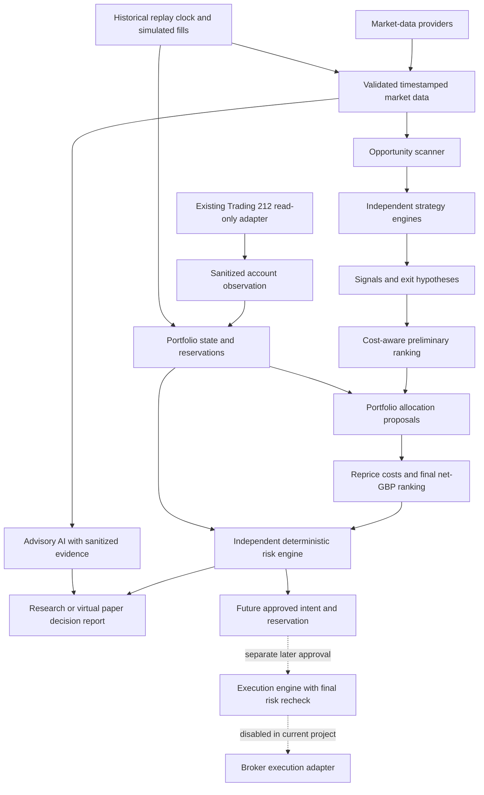

# Atlas architecture — Phase 2B implementation and future design

Status: updated 26 October 2026 after the approved offline Phase 2B implementation.
The components listed below are implemented; broader production components in
the intended flow remain future design. See
[claude_trader_evaluation.md](claude_trader_evaluation.md) for the
two reviewed repositories and source evidence.

## Existing architecture

| Existing file | Observed responsibility |
| --- | --- |
| `src/atlas/config.py` | Immutable Settings, process-environment credentials, demo-only validation and safe user errors |
| `src/atlas/broker.py` | HTTP Basic authentication; one fixed demo account-summary GET; timeouts, bounded retries, pacing and minimal Decimal summary |
| `src/atlas/main.py` | Offline health and read-only broker-check commands |
| `src/atlas/research.py` | Configurable GBP 1,000 opening ledger and provisional risk budgets; no fills, risk approvals or execution |
| `src/atlas/domain.py` | Validated immutable instruments, units, UTC data, signals, costing, ranking, portfolio, risk and audit contracts |
| `src/atlas/sessions.py` | Injectable clock and calendar protocols, explicit session fixtures and bar completeness checks |
| `src/atlas/synthetic.py` | Original UK/US data, FX and synthetic fee fixtures, provenance and fixture exporters |
| `src/atlas/costs.py` | Effective-dated explicit cost assumptions, Decimal arithmetic and bid/ask spread treatment |
| `src/atlas/portfolio.py` | GBP-base simulated ledger, cash, positions, partial fills, reservations and reconciliation |
| `src/atlas/risk.py` | Independent fail-closed evaluation and atomic approve/reserve; no broker sender |
| `src/atlas/strategy.py` | Versioned five-minute ORB hypothesis with explicit opening-range duration |
| `src/atlas/backtest.py` | Availability-ordered synthetic replay, local fills, costs, risk and complete reports |
| `src/atlas/research_cli.py` | Offline commands and non-secret example JSON loading; no broker credential loading |
| `scripts/broker-check.ps1` | Local credential entry, optional clipboard input and temporary process environment |
| `tests/test_broker.py` | 40 existing mocked/offline cases covering connectivity, errors, safety and credential diagnostics |
| `tests/test_research.py` | 40 offline cases for defaults, configuration, synthetic scenarios, validation, reporting and broker/ledger independence |
| `tests/fixtures/research_scenarios.json` | Original GBP 1,000 baseline and configured-capital/percentage scenario; exact monetary expectations |
| `pyproject.toml` | src package layout; HTTPX runtime; pytest/Ruff development tools |

There is no external market-data provider, whole-market scanner, calibrated
net-profit ranker or broker order sender. The offline strategy, ledger, risk and
replay are implemented. An account summary is not an authoritative
positions/open-orders/fills snapshot. Planned simulated
capital defaults to GBP 1,000; never infer that the broker's Practice balance equals it.

`ResearchSettings.from_environment()` centralizes the starting capital and initial
simulation percentages. `VirtualLedger(settings)` opens with that configured GBP
cash independently of broker observations. Defaults are planned risk per trade
0.5%, daily loss threshold 1%, and maximum concurrent planned risk 1%: GBP 5, GBP
10 and GBP 10 at GBP 1,000. All three percentages are configurable and use initial
capital as the fixed denominator, with GBP budgets rounded down to pennies.
These are provisional research settings, not proven optimal parameters or
guaranteed loss limits. The independent Phase 2B risk engine enforces these
provisional settings for local simulation; see the [specific risk/accounting and
fill assumptions](backtesting_assumptions.md).

Preserve these files and their public behavior. A future read-only facade can wrap
the existing client without changing its endpoint or adding order methods.
Use a modular Python application on this laptop initially, not distributed
services. Separate responsibilities through typed contracts and restricted
dependencies before introducing more infrastructure.

## Intended flow



Dashed paths are design placeholders, not implemented capabilities. The Phase 1
account observation alone cannot populate a complete portfolio ledger; future
reconciliation needs explicitly specified read-only position/fill inputs.
Backtesting drives the same deterministic strategies, costing and risk rules
using historical clocks and a simulated ledger. Monitoring observes every stage.
Advisory AI has no path to execution, credential storage, policy edits or risk approval.

## Component boundaries

| Component | Owns | Must not do |
| --- | --- | --- |
| Market-data providers | Authorized retrieval, provider symbols, quotas, raw provenance and normalized bars/quotes | Infer trade approval or use broker credentials |
| Opportunity scanner | Universe filtering, liquidity/spread/data-quality eligibility, setup candidates and scan coverage | Force a trade, conceal partial results or claim economic edge from a pattern |
| Strategy engines | Independent versioned entry/exit hypotheses and deterministic signals | Call providers directly, share hidden mutable state or place orders |
| Signal ranking | Comparable after-cost GBP expectancy, uncertainty and evidence quality | Treat AI prose, win rate or simulated hit rate as calibrated expected return |
| Portfolio management | Positions, cash, valuations, fills, reservations and feasible allocation proposals | Assume an intended trade is already filled or fund new buys with unconfirmed sells |
| Independent risk engine | Fail-closed eligibility and size approval against current aggregate state | Accept strategy/AI overrides or silently relax policy |
| Broker adapters | Read-only observations now; narrowly scoped future broker-specific mappings | Supply strategy logic or choose the live environment dynamically |
| Execution engine | Future lifecycle, idempotency, final risk validation, reconciliation and kill-switch handling | Exist as an active sender in Phase 2A/2B or accept an unchecked intent |
| Backtesting | Historical clock, as-of data access, executable fill assumptions and chronological evaluation | Read future data or use outcome-based selection to choose a strategy |
| Monitoring | Structured decisions, latency/freshness/coverage metrics and redacted audit events | Log credentials, raw authorization headers or full private broker payloads |
| Advisory AI | Optional research hypotheses, cited summaries and explanations | Access broker keys/order tools, mutate authoritative state or approve risk |

No scanner result is a valid and successful outcome. Distinguish "no candidate",
"candidate rejected", "partial scan", "market closed" and "provider failed".
The allocation engine may leave all capital in cash.

## Contracts to specify before implementation

The core contracts are implemented in domain.py. ScanResult and statistically
calibrated opportunity ranking remain future work; synthetic RankedOpportunity
objects are explicitly research-only.

| Contract | Minimum fields and invariants |
| --- | --- |
| Instrument | Internal identity, asset class, venue/MIC where applicable, listing/ISIN where available, provider aliases, quote currency/unit, tick/quantity increments and broker mapping status |
| Bar / Quote | Event time, availability time, received time, UTC interval bounds, completion flag, OHLCV or bid/ask, source, adjustment mode and quality flags |
| ScanResult | Universe/data snapshot IDs, as-of time, eligible/requested/fetched/rejected counts, per-source failures, partial flag and candidates |
| StrategySignal | Strategy/version/parameters, instrument, direction, decision time, last available input time, horizon, entry/exit rules, evidence ID and expiry |
| CostEstimate | Feasible quantity, GBP gross outcome assumptions, spread/slippage/fees/FX/tax components, rate-table version, uncertainty and data sufficiency |
| RankedOpportunity | Signal ID, quantity assumption, net-GBP expectation and conservative bound, horizon, capital/risk usage, calibration period and score provenance |
| PortfolioSnapshot | As-of time, cash by currency, positions, valuation times, realized/unrealized P&L, unsettled/reserved amounts, source and version |
| RiskDecision | Approved/rejected/research-only, reason codes, policy/snapshot versions, intent hash, maximum quantity, reservation ID and expiry |
| AuditEvent | Correlation/run ID, UTC time, component/version, input references, decision/reason codes and redacted metadata |

Use timezone-aware UTC internally, exchange-local sessions at the boundary, and
a clock interface for deterministic replay. Resolve exchange holidays, half-days,
auctions and London/New York daylight-saving changes without treating fixed
local times or finite hand-written holiday lists as permanent rules.

Do not use a display ticker as a global identity. Preserve LSE pence-versus-pound
units explicitly and normalize before costing; a factor-of-100 error must fail
tests. Distinguish a provider's listing symbol, the internal instrument and a
Trading 212 instrument identifier. Forex instruments need base/quote currencies,
quantity units and their own calendars/conventions, not stock ticker assumptions.

## Expected profitability and selection

All outcomes must use a common GBP account currency and a declared horizon.
A proposed deterministic calculation is:

`expected_net_gbp(q) = sum(p_i * gross_pnl_gbp_i(q)) - expected_round_trip_cost_gbp(q)`

Outcome probabilities must sum to one and include time-based exits, no-fill and
gap/stress outcomes where relevant. Estimate the joint outcome/cost relationship
when costs depend on the scenario. Deduct costs only once: a bid/ask fill model
already includes its spread; a spread estimate must not be subtracted again.
Commissions, slippage, conversion charges and applicable transaction taxes require
effective-dated instrument/account-specific inputs. No fee or tax rate is assumed
in this design; verification against authoritative terms is a future task.

Use held-out observations to estimate/calibrate distributions. Monte Carlo
resampling is a stress/research aid, not independent evidence or an automatic
probability source. Report sample size, confidence and sensitivity to higher costs.
Win rate, reward:risk, pattern score and positive gross P&L alone do not qualify.

Preliminary ranking may use a feasible trial quantity. Portfolio allocation then
proposes sizes against available cash/exposure. Recompute costs and final ranking
at those sizes, since rounding and fixed fees can change ordering. Risk must
independently re-evaluate the exact final proposal. Do not silently change size
after approval. Compare absolute expected net GBP and uncertainty, with horizon
and capital efficiency as explicit secondary criteria; avoid an opaque blended score.

Permit zero trades when conservative net benefit is nonpositive, evidence is
insufficient, data/cost inputs are missing, or deterministic risk rejects the idea.
For a GBP 1,000 ledger, minimum quantities, rounding and FX costs can make an
otherwise interesting signal infeasible. This is an expected result, not a reason
to widen risk limits or force deployment of cash.

## Risk and portfolio state

Begin research with long-only unlevered equities as a proposed scope, subject to
approval. Keep FX paper research in its own virtual ledger. Do not copy upstream
USD risk defaults or recommend a numerical loss limit from an example config.
The current user-selected 0.5%/1%/1% research settings are independently specified
in Atlas configuration; do not treat them as validated trading policy.

Risk checks need, at minimum:

- Approved asset/venue/session, unambiguous instrument and fresh complete data.
- Finite positive prices/quantities, correct currency units, tick/quantity
  increments, supported order semantics and affordable worst-case cost.
- Per-trade stressed loss, aggregate open/pending risk, daily drawdown,
  concentration/correlation exposure and maximum capital utilization.
- Available cash net of reservations, known settlement treatment, no unsupported
  leverage/short positions and no duplicate intent.
- Consistent ledger/account snapshot, strategy/evidence status, trading halt or
  kill-switch state, policy version and approval expiry.

A stop is a policy exit trigger, not a guaranteed loss cap. Distinguish planned
stop loss from stressed gap/slippage loss and from actual realized/unrealized P&L.
Unknown market data, cost policy or portfolio state prevents approval of new risk.
Position-reducing actions need a separate future policy; do not inherit a blanket
"never block sells" rule without verifying the position and pending orders.

For eventual execution, reserve cash/exposure atomically with the decision and
revalidate just before dispatch against current state. A same-day JSON PASS or
order hash is insufficient authority. Track partial fills, rejected/unknown
responses, cancellations and cash movements. Reconcile before retrying uncertain
execution; do not reuse the read-only client's GET retry semantics for orders.
These execution capabilities remain unimplemented and require separate approval.

## Research validation

Use a local immutable dataset manifest: provider, permitted use, checksum,
requested universe, coverage, retrieval time, adjustment policy and calendar
version. Make publication/availability time distinct from event time. Preserve
corporate actions, delistings and historical universe membership where available;
document exclusions when data cannot support them.

Replay at the next actionable price after a completed signal, with explicit
latency and conservative spreads/slippage. Model partial/no fills and worse gap
fills; an OHLC bar cannot reveal exact event ordering. A conservative stop-first
rule can be one sensitivity case, not proof of real execution.

Use chronological train/validation/test periods. Purge or embargo overlapping
holding intervals where applicable, fit every transformation inside its training
window, freeze parameters before test folds, and reserve an untouched final
holdout. Evaluate each strategy independently before a combined portfolio.
Record all attempted variants to control selection bias. Report net expectancy,
drawdown, turnover, exposure, tail outcomes, trade counts and uncertainty across
regimes and cost stresses. No numerical promotion threshold is invented here.

## AI and security boundary

The default research pipeline must run without an LLM. Optional AI sees only
public documents and selected sanitized research outputs, through a schema with
provenance. Its suggestions enter a research inbox for independent validation.
Never let news, filings or SKILL.md text invoke tools or alter risk policy.

Do not put either reviewed pack in `.claude/skills`, configure its MCP connectors,
or import its downloaded scripts. Keep source snapshots outside package paths,
pin source revisions and preserve notices for any approved future port. Separate
data credentials from broker credentials; AI receives neither. Keep request
allowlists, timeouts, bounded retries, resource limits and redaction at boundaries.

## Proposed future package map

```text
src/atlas/
  config.py, broker.py             existing Phase 1 broker files, preserved
  main.py                         existing CLI, health now reports research settings
  research.py                     implemented opening ledger/settings foundation
  domain/                         identities, clocks, contracts and reason codes
  data/                           provider interfaces, normalization and quality
  scanner/                        discovery and coverage reporting
  strategies/                     separately versioned deterministic rules
  costs/                          effective-dated costing and currency conversion
  ranking/                        evidence-based net-profit comparison
  portfolio/                      ledger, allocation, reservations and reconciliation
  risk/                           independent deterministic policy engine
  backtest/                       as-of replay, simulated fills and walk-forward runs
  monitoring/                     sanitized events and operational metrics
  advisory/                       optional AI research inbox, no broker dependencies
  brokers/                        future read-only facades / approved adapters
  execution/                      reserved design boundary; no sender in Phase 2B
```

The package map above remains the longer-term target, not the current directory
tree. Phase 2B implements domain.py, sessions.py, synthetic.py, costs.py,
portfolio.py, risk.py, strategy.py, backtest.py and research_cli.py as small Python
modules. This preserves separation without unnecessary packages/services.
Provider procurement, authoritative calendars, real-data validation, production
walk-forward research, ISA compatibility and any order capability remain separate work.
