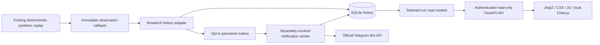

# Phase 2C architecture

27 October 2026. **SYNTHETIC RESEARCH ONLY — NOT LIVE TRADING PERFORMANCE.**

Gate 0 passed before Phase 2C code: all 292 existing tests, including the three
acceptance regressions, passed; Ruff lint and formatting passed. The remediations
in [the acceptance audit](phase2b_acceptance_audit.md) were inspected. Phase 2C
adds observation hooks, not changes to those risk/exit/calendar policies.

## Boundaries

| Module | Responsibility |
| --- | --- |
| `activity.py` | Schema-v1 events, typed allowlisted payloads, Decimal/UTC validation and snapshot consistency |
| `history.py` | Atomic schema migrations, WAL transactions, run leases, immutable insertion semantics, backup, auth storage and outbox claims |
| `research_history.py` | Converts actual replay observations to events; never supplies risk approval or ledger fills |
| `dashboard_models.py` | Bounded selected-run queries and derived presentation metrics |
| `dashboard_security.py` | Scrypt password hashes, opaque sessions, rate limits and explicit binding policy |
| `web/app.py` | Authentication, static templates/assets and read-only APIs |
| `notifications.py` | Provider protocol, safe formatting, Telegram transport and bounded delivery attempts |
| `telegram_setup.py` | Masked local input and nonce-verified private chat discovery |
| `dashboard_cli.py` | Explicit setup, server, backup, preview and delivery commands |

Pydantic is used for activity/API contracts. FastAPI, Jinja2 and Uvicorn are the
optional `dashboard` extra; SQLite, password hashing and transaction coordination
use the Python standard library. Existing HTTPX is reused for Telegram.
Chart.js 4.5.1 is vendored with its MIT license and verified npm integrity manifest;
charts require no CDN, Node build, external fonts or AI service.
See [FastAPI templates](https://fastapi.tiangolo.com/advanced/templates/) and
[Chart.js distribution guidance](https://www.chartjs.org/docs/latest/getting-started/installation.html).

## Events and clocks

### Optional owner-approved multi-recipient notifications

The later multi-recipient extension adds `telegram_recipients_store.py`
(private schema/approval/preferences), `telegram_recipients.py` (masked local
owner CLI), and `telegram_fanout.py` (per-recipient/event jobs and aggregate
status). It consumes the existing event outbox without changing research event
IDs, accounting, strategy/risk policies, `HistoryStore` or its ownership fence.

Private `telegram_*` tables use their own schema version 1 alongside core schema
3. Chat IDs/preferences are now intentionally persisted there, outside public
activity payloads; bot tokens never are. Recipient actions require an authenticated
owner session, with authorization checked inside the mutation transaction.
Nonce proof saves PENDING, and a separate owner approval enables the subscription.
Synthetic alerts and PNGs require individual opt-ins as well as sender enablement.

Fanout captures fixed recipients per eligible source event and creates independent
delivery IDs, retry counters, leases, audit and photo uncertainty state. Results
and audit commit atomically. A disabled/removed subscription cancels outstanding
jobs and invalidates stale senders; HTTP already in flight cannot be recalled.
Source sequence boundaries prevent historical backfill to new recipients.
Multicast mode is persistent and never silently falls back to legacy delivery.

Dashboard status exposes aggregate job counts only. Detailed per-recipient audit
is owner CLI, not the public activity feed. `/start` never authorizes a sender;
private `/stop` requests are applied only by explicitly invoked owner opt-out
sync, with a durable update cursor. No background poller was introduced.
See [the recipient architecture/verification report](telegram_multi_recipient_report.md)
and [exact administration commands](telegram_setup.md).

Each event includes a stable SHA-256 ID, event type, environment, UTC event/
availability/processing timestamps, run ID, versioned strategy, instrument,
correlation/causation IDs, schema version and validated payload. Database sequence
is the ingestion/causal order. A cause must already exist in the same run.

`clock_domain=RESEARCH` identifies synthetic market time; notification operations
use `WALL` time. A future-dated artificial fixture can have a virtual timestamp
after actual processing time. These clocks are deliberately separate; operational
messages are not reordered ahead of their cause using virtual dates.

Contracts reserve SYNTHETIC/PAPER/LIVE names, but storage accepts only SYNTHETIC.
No runtime paper/live mode or broker execution capability is enabled.

Implemented event types cover research, scan contracts, signals, risk decisions,
intents, confirmed/partial simulated fills, position transitions, valuations,
breaches, kill switch, errors and notification attempts/results.
No scan or kill-switch event is fabricated: no scanner or dashboard kill-switch
action exists. Actual default risk state is observed from the existing engine.

## Persistence and idempotency

Database defaults to `local/atlas-history.sqlite3` in this editable project.
`ATLAS_HISTORY_DB` or `--history-db` selects another private local path.
Database files, WAL/SHM sidecars, local configuration, keys and virtualenv are ignored.

Database schema 1 introduced runs/events/outbox/auth. Atomic migration 1→2 adds
non-secret notification configuration observations. Migration 2→3 adds the
`run_attempts` ownership-identity registry and backfills existing non-null owners;
existing event IDs, reports and outbox entries are preserved. A newer unsupported schema
fails closed. DDL and state transitions use explicit transactions; writers use
`BEGIN IMMEDIATE`, foreign keys, five-second busy timeout and WAL. Multi-query
event pages use read transactions. Schema/event versions are distinct.

The run identity includes dataset content, settings, strategy, fee/calendar
assumptions and source fingerprints (including the adapter/schema/storage code).
Repeating identical inputs/code does not insert a second trade history or outbox.
`--new-run` explicitly creates a separate experiment, with its own starting cash.
Portfolios and charts never add together balances/P&L from separate experiments.

A run has a 30-second heartbeat lease while the CLI is executing. Recent heartbeat
is evidence of observed activity, not proof of a healthy PID. Expired RUNNING
leases display INTERRUPTED/ERROR rather than an indefinitely healthy bot.

### Research-worker ownership fence

Each recording attempt already receives a fresh UUID from `recorded_backtest`.
Schema 3 also durably prohibits reusing an attempt identity for the same run,
including after expiry, failure, takeover and process restart. A takeover records
the fresh identity in the same transaction that changes the current owner.
This prevents an old identity from becoming authoritative again (the ABA problem).
The identity is an internal coordination value, not an authentication credential.

`claim_run`, `heartbeat`, `complete_run` and `fail_run` use short SQLite
`BEGIN IMMEDIATE` transactions. Wall time is sampled after acquiring the writer
transaction. Renewal and terminal commits require the matching current owner,
RUNNING status and a strictly unexpired lease. Terminal ownership validation and
event/outbox/status writes share that transaction: another process cannot transfer
ownership between the check and mutation. The check is the linearization point;
the SQLite writer lock excludes takeover throughout the ensuing atomic commit.
Research computation and network delivery never run inside this transaction.

Completion rejects stale attempts and commits one consistent completion event,
the observation batch, report, status and any opted-in outbox entries together.
Cross-run or contradictory/duplicate terminal batches roll back. Failure commits
its stable `failure-{owner}` event, ERROR status and optional alert together only
for the current valid owner. Stale, expired or repeated failure callbacks return
false without writes, preserving the adapter's original exception; genuine
current-owner failures are still recorded. Whichever concurrent terminal callback
commits first consumes RUNNING ownership; later callbacks cannot add a second
outcome. Notification delivery has its separate existing fenced outbox claim and
does not change research ownership or accounting.

Stop old research, dashboard and notification processes before adopting this
revision, make an online SQLite backup using the documented backup command, then
restart with this code. Schema migration runs on store opening. An already-running
old interpreter is not retroactively patched by a database migration. Existing
historical false alerts are not silently deleted or automatically resent.
The user database was not migrated or cleaned during remediation verification;
all verification used isolated test/history databases.

During execution, observations are bounded in memory (10,000 maximum) and leases
are renewed. The complete event/report/outbox batch commits atomically at run
completion. Failed or interrupted writes cannot expose half an imported portfolio.
A known engine/persistence failure records a static error when the database is
usable. If the database itself is unavailable, the CLI fails explicitly; durable
notification delivery cannot be promised without a usable outbox.

**Restart recovery restores dashboard history, not an in-flight trading ledger.**
An expired lease can rerun the deterministic fixture from its initial state; this
is not durable reconstruction or continuation of a partially executed ledger.
There is no automatic retry into broker execution.

## Authoritative values

Every valuation comes from PortfolioLedger.snapshot; fills come from its confirmed
history, signals/decisions from the existing strategy/risk engine. The browser
does not implement accounting or approve trades. Read models derive return and
chart metrics from those observations using Decimal. Chart number conversion is
for rendering only; there is no monetary feedback into risk.

GBP reporting and GBX /100 normalization retain actual fixture FX. Native average/
mark conversions are valid for Phase 2B's constant-FX synthetic run model.
Unavailable/stale FX yields N/A with a reason, not an invented rate.
Unrealized carrying-value P&L includes entry costs and excludes future exit costs;
it is not a guaranteed liquidation value.

Adverse realized losses are compared with the recorded RiskDecision's planned
risk and explicitly highlighted. This is observation, not a changed risk policy.
Remaining risk budget stays N/A for historical/stale snapshots.

## Delivery isolation and security

Only opted-in confirmed fills/alerts (optionally completion summaries) enter the
outbox. A signal/intent never becomes a trade notification. Delivery requires an
explicit sender command, enabled local configuration and synthetic opt-in.
Dashboard startup and ordinary backtests never send Telegram messages.

Outbox rows are unique per source event; workers claim under a transaction,
with a global one-second gate, leases, five-attempt maximum and persistent backoff.
429 delays are respected. Crashed final attempts become an explicit uncertain
failure. Delivery audits do not update positions, cash, fills or replay results.

Telegram can accept a message before its response is lost. A retry can duplicate
that message; exactly-once network delivery is not guaranteed. Nothing in that
retry path can duplicate a portfolio side effect.

All requests use fixed official Telegram methods/origin, TLS, timeouts, no
redirects/proxy discovery and static error codes. Token-bearing transport logs
are redacted. Tokens are never persisted or put in HTML/status APIs. Legacy
single-recipient chat IDs remain ephemeral; explicitly enrolled recipient IDs
are persisted only in the private registry described above, never public events
or status responses. Preview never loads credentials or contacts Telegram.

Dashboard credentials use salted scrypt (N=32768, r=8, p=1), with 32-byte derived
hashes. Session cookies contain random opaque tokens; only hashes are stored.
Cookies are HttpOnly, SameSite=Strict, host-only and expire after eight hours;
Secure and HSTS apply under TLS. Password replacement revokes all sessions.
Login failures are rate-limited per client and globally across restarts.

The server defaults to 127.0.0.1:8000. LAN requires a specific RFC1918 IPv4 address,
explicit flags and authentication; wildcard/public binds are rejected. Plain
LAN HTTP additionally requires an unencrypted-access acknowledgment. Strict host/
origin validation, CSP, static validation errors, bounded bodies/queries and no
access logging reduce exposure. There is no router/firewall/tunnel automation.

This is a single-user local research app, not a hardened public-facing service
or cryptographically tamper-proof audit ledger.

