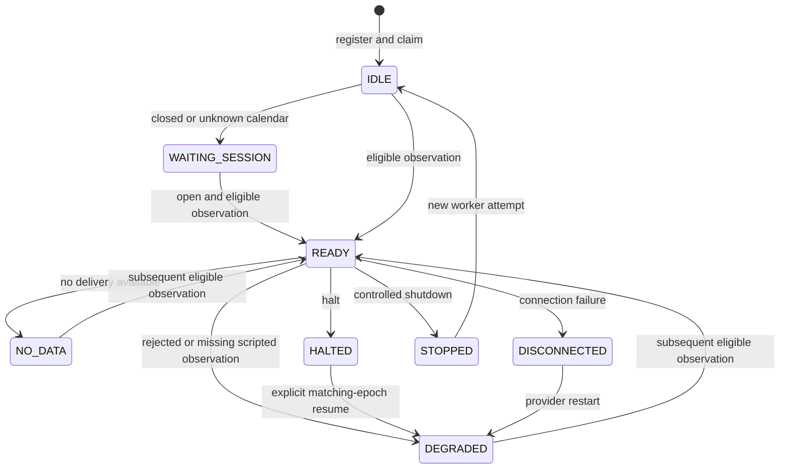

# Phase 4A: paper data and session scheduling

Phase 4A adds **offline, read-only eligibility evidence** for current observations. It
does not call a strategy, create an intent, simulate a fill, change accounting, contact
a broker, or enqueue a notification. All observations and entitlement responses are
artificial. A successful assessment is not permission to execute an order.

## Architecture and compatibility

`atlas.paper_data` contains seven modules:

| Module | Responsibility |
| --- | --- |
| `contracts` | Immutable, versioned observations, configuration, policy and mock entitlement evidence |
| `gates` | Pure feed, entitlement and observation validation with explicit reason codes |
| `mock` | Stateless, cursor-addressed artificial feed and reproducible fault scripts |
| `store` | Separate SQLite database, durable checkpoints, ownership and fencing |
| `scheduler` | One bounded session-aware scan; persists evidence without dispatch callbacks |
| `cli` | Offline JSON diagnostics and finite replay harness |
| `__init__` | Package boundary |

The historical `Contract`, `HistoricalInstrument`, effective `SymbolMapping`, digest
and canonical JSON conventions are reused. `HistoricalCalendar` supplies actual UTC
session boundaries and complete versioned calendar provenance. Existing domain
currency, quotation units and venue enums remain authoritative.

Historical download storage, backtest availability rules, risk evaluation, portfolio
accounting and dashboard/history/outbox storage are unchanged. `atlas.main` routes
`paper-data` before environment settings or dashboard/broker initialization. The
dashboard does not start this scheduler, and this phase adds no dashboard endpoint.
The snapshot interface is available for a separately reviewed future integration.

## Observation contract

Each `Observation` has an instrument ID, provider ID, effective provider symbol,
provider process epoch, exchange, quote currency, quote unit, positive finite Decimal
price and nonnegative finite Decimal volume. Source identity is explicit through
`observation_id`, `source_reference`, schema version and the fixed
`ARTIFICIAL_OFFLINE_MOCK` provenance.

Three required fields preserve independent clocks:

1. `event_at`: when the market event occurred.
2. `available_at`: when the provider made it available; explicitly nullable if unknown.
3. `received_at`: when the local observer received it.

No field defaults to receipt time. Numeric epochs, date-only strings, naive datetimes,
non-UTC offsets and invalid ISO datetimes are refused. The required relationship is
`event_at <= available_at <= received_at`; when availability is unknown, event must
still precede receipt. Missing availability is retained as `None` and fails the gate.
Mock generation intentionally defines each artificial clock; it does not infer a
missing source clock during validation or ingestion.

Only NYSE/NASDAQ equities with USD quotation/currency are supported in this phase.
Unknown units and malformed metadata fail construction. At assessment, instrument,
venue, currency, unit, symbol and the half-open effective mapping interval must match
the configured instrument. Provider identity is restricted to `mock-current-v1`.

Finality is `FINAL`, `PROVISIONAL` or `REVISED`, with an explicit revision number.
Provisional and revised data are retained but ineligible. An observation always begins
with `UNCHECKED` freshness; callers cannot assert it is fresh in its source payload.
The separate immutable assessment records evaluated freshness, reasons, eligibility,
paper classification, entitlement status and assessment time.

## Freshness and entitlement policy

| Configurable policy | Default |
| --- | --- |
| Maximum event age for realtime/replay | 30 seconds |
| Maximum event age for delayed observations | 930 seconds |
| Maximum receipt age | 10 seconds |
| Maximum provider-availability-to-receipt transport lag | 5 seconds |
| Maximum actual provider delay for realtime classification | 2 seconds |
| Delayed observations allowed | False |
| Replay observations allowed | True |
| Scan interval | 1 second |
| Worker lease | 30 seconds; API allows positive durations up to one hour |

Age equality at a configured limit passes. Future receipt and clock regression have
zero tolerance. All failures are accumulated in stable order and fail closed. Both
the market event and assessment must belong to the same eligible regular session.
An old session's observation cannot become eligible during the next session.

`verify_entitlement` uses only a validated `MockEntitlementResponse`. It checks the
verified flag, permission for paper use, exchange/unit/provider scope, verification
and expiration boundaries, and explicit matching feed delay. Verification is valid
at `verified_at` and invalid at `expires_at`. Unknown delay or missing delay seconds
fails. A returned `MOCK_ONLY` verification never verifies a real subscription.
Each observation audit saves the response and resulting entitlement status.

The gate assigns classifications, rather than trusting a source label:

| Classification | Requirements beyond the common gates |
| --- | --- |
| `PAPER_REALTIME` | Matching mocked realtime entitlement, declared zero delay, actual event-to-availability delay within the realtime threshold |
| `PAPER_DELAYED` | Explicit delayed policy opt-in, matching verified mock delay, actual delay at least the declared delay, event age within the delayed threshold |
| `PAPER_REPLAY` | Explicit replay feed/entitlement, replay enabled, normal session and freshness gates evaluated against the injected replay clock |
| `PAPER_UNAVAILABLE` | Any failed gate, missing observation, control event, halt or disconnect |

No classification here describes actual market connectivity. The default delayed
mock declares 900 seconds. It remains delayed even if its local receipt is recent.
`validate-feed` also checks mapping effectiveness and whether delay/replay policy can
admit the configured feed. `entitlement` reports entitlement independently of a
disabled feed policy. Neither command performs an authenticated request.

## Scheduler state machine

The host drives `SessionScheduler.scan(lease)` with an injected UTC clock. Each call
does at most one due mock poll and produces no strategy execution. Missed scan slots
are not backfilled; the next due time is the actual scan time plus the interval.



These are stored diagnostics, not execution states. Any active state can become
`WAITING_SESSION` or `STOPPED`; halt/connectivity flags remain separately durable.
An expired lease makes `owner_active=false` without rewriting the stored status.
A takeover returns to `IDLE` and preserves controls and checkpoints.

The scheduler polls only within `[open, close)`. Holidays, weekends, early closes,
March/November DST changes and unknown calendar coverage are handled by the existing
calendar. Session and ownership are checked again after polling. Nasdaq retains the
existing documented `XNYS` schedule alias. Calendar coverage, library/tzdata versions,
effective boundaries and the alias are included in the stream fingerprint.

Halts persist until explicit resume. A provider restart can restore connectivity and
change provider epoch, but cannot release an exchange halt or reset deduplication.
Observations and resume events from an unannounced epoch fail closed.

## Durability, ownership and recovery

Use a dedicated `.sqlite3` or `.db` file. Schema version 1 contains:

- `paper_meta`: schema identification; foreign or unsupported databases are refused.
- `paper_streams`: configuration fingerprint, cursor, accepted-event high-water mark,
  next due time, latest scan time/outcome, durable control state, owner, fence and lease.
- `paper_attempts`: previously acquired attempt identifiers; reuse is refused.
- `paper_results`: one audit record per consumed mock event and source ordinal.
- `paper_seen`: per-stream observation identities and source-content checksums.

SQLite uses `BEGIN IMMEDIATE`, rollback/DELETE journaling, `synchronous=FULL`, foreign
keys and a bounded five-second busy timeout on each connection. Read diagnostics use
SQLite `mode=ro`; they neither create a missing database nor claim work.

Acquisition samples time after obtaining the write lock and increments a durable
fence. Every heartbeat, scan and shutdown checks stream, attempt, fence and strict
unexpired lease ownership in the transaction. Time regression refuses mutations.
Fencing is rechecked before persisting the event. A stale worker cannot renew its
lease, advance a cursor, insert an audit or clear a successor's ownership.

The cursor, seen identity, accepted-event high-water mark, control changes and audit
result commit together. A crash before commit leaves the event available for a new
worker after expiry; a crash after commit resumes at the next cursor. Restart requires
the same feed, policy, calendar provenance and mock-script fingerprint. Entitlement
evidence may be refreshed; each scan stores the evidence actually assessed.

Deduplication identity is provider + instrument + provider observation ID + revision,
hashed canonically. Content comparison excludes local receipt and process epoch, so
redelivery after restart is still a duplicate. Changed source content under the same
identity is an identity conflict. Accepted event times must strictly increase, even
across restarts. Rejected observations are also marked seen; entitlement recovery
requires a subsequent new observation rather than retroactive eligibility.

Shutdown commits `STOPPED` and releases ownership, preserving progress. The finite
CLI harness shuts down in `finally`, including interruption; interrupted CLI runs
return 130. Actual process death leaves ownership until its lease expires.

## Offline CLI

From the repository root, PowerShell examples:

```powershell
.venv/Scripts/python.exe -m atlas.main paper-data validate-feed --json
.venv/Scripts/python.exe -m atlas.main paper-data entitlement --json
.venv/Scripts/python.exe -m atlas.main paper-data entitlement --unverified --json
.venv/Scripts/python.exe -m atlas.main paper-data replay --db local/paper/demo.sqlite3 --scenario duplicate --json
.venv/Scripts/python.exe -m atlas.main paper-data state --db local/paper/demo.sqlite3 --json
.venv/Scripts/python.exe -m atlas.main paper-data ownership --db local/paper/demo.sqlite3 --json
.venv/Scripts/python.exe -m atlas.main paper-data freshness --db local/paper/demo.sqlite3 --json
.venv/Scripts/python.exe -m atlas.main paper-data replay --db local/paper/delayed.sqlite3 --scenario delayed --allow-delayed --json
```

All output is JSON, with or without `--json`. Validation/entitlement failures return
1. Completed replays return 0 even when their purpose is demonstrating rejected data;
read `counts`, `reasons` and `mode`. Unexpected configuration/store failures return a
sanitized error without echoing input values.

Replay scenarios are `ordered`, `delayed`, `missing`, `duplicate`, `out-of-order`,
`halt`, `connection-failure`, `provider-restart`, `session-transition`, `stale`,
`missing-availability` and `unknown-delay`. The default explicit script origin is
`2026-10-28T14:00:00Z`. `--at` changes that origin, `--venue` selects XNYS/XNAS,
and `--now` separately supplies a recovery clock. Keep script origin and configuration
unchanged when resuming. Each invocation uses a new UUID attempt unless supplied.

Optional public JSON configuration has required `feed` and optional `policy` and
`entitlement` objects, using the corresponding contract fields. Only `.json` files
up to 100000 bytes are read; credential paths are rejected. No environment settings
or credentials are loaded. Reuse a checkpoint only with the same effective configuration.

State and ownership show current lease activity. Freshness shows persisted scan-time
failures, latest scan outcome, policy and aggregate counts; up to 100 recent audit
records are inspected. It does not claim saved observations are still fresh now.

## Limitations and Phase 4B dependencies

- Offline mock only; no provider adapter, real entitlement verification, broker calls,
  notifications, subscriptions or execution. No automatic daemon or deployment is added.
- One instrument/feed per stream; exact-once guarantees concern committed evidence
  per stream, not future strategy/order side effects.
- Calendar coverage remains bounded by existing infrastructure (2000–2030, at most
  368 days per materialization). Community exceptional-closure coverage and the Nasdaq
  alias remain limitations. Changing coverage requires a new stream or a reviewed migration.
- Regular cash sessions only; no extended hours, auction model or external halt source.
  A closed-session tick keeps pending feed data unconsumed; stale or prior-session
  observations will fail when the next eligible session opens.
- A host must provide a trustworthy UTC clock, timely heartbeats and single-host local
  SQLite storage. Clock regression stops writes. Distributed leases, network filesystems,
  malicious clock jumps and physical power-loss durability are not certified here.
- The finite CLI harness accepts inter-event gaps below its lease safety limit; a long
  gap is refused rather than renewing an expired token. Programmatic hosts can heartbeat
  between ticks. The CLI calendar covers script date and the following date.
- Strict event-time ordering rejects different ticks with equal timestamps. Corrections,
  sequence-number ordering, corporate actions and bar aggregation need an explicit policy.
  No observation-to-research-quote or execution adapter exists.
- No retention/compaction or schema migration tooling is supplied. Large feeds and
  cross-process operational deployment require further capacity and recovery review.

Phase 4B can consume the contracts and checked checkpoint interface after defining
strategy state persistence, observation-to-strategy semantics, fresh FX/portfolio/risk
inputs, exactly-once intent handling and simulated execution/accounting boundaries.
All existing risk checks must remain mandatory. Those changes are not implemented here.
