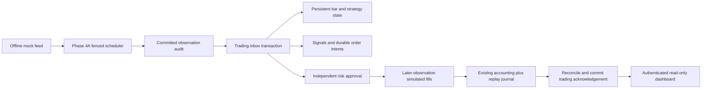

# Phase 4B: durable offline paper execution

Date: 2026-10-28. Scope: original artificial US equity observations, virtual GBP
1,000, local SQLite, no broker or external market-data connectivity. Mock entitlement
evidence establishes no real subscription or provider permission.

## Components and reuse

`atlas.paper_execution` adds six modules:

| Module | Responsibility |
| --- | --- |
| `engine` | Trading-inbox transaction, sampled bars, persistent strategy transitions, intent lifecycle and simulated fills |
| `ledger` | Public-operation replay, sealed projections, reconciliation and read-only account report |
| `codec` | Closed JSON type vocabulary; exact Decimal and UTC timestamp recovery, without pickle or dynamic imports |
| `mock` | Original deterministic opportunity/no-opportunity sessions, synthetic costs and explicit artificial FX |
| `cli` | Offline finite session driver, recovery, state and persistent kill control |
| `__init__` | Isolated package boundary |

The Phase 4A package remains unchanged. `PortfolioLedger`, `ResearchSettings`,
`CostEngine`, `ORBStrategy`, `RiskEngine`, domain contracts and the maintained
`HistoricalCalendar` remain authoritative. Initial capital is always
`ResearchSettings()`'s explicit GBP 1,000 default; no environment or broker balance
is loaded. The engine supports one artificial USD equity per account/database,
integer shares, a USD 0.01 tick, long-only holdings, no margin and no leverage.

The existing `RiskEngine.authorize` performs the independent entry decision and
reservation. Its public `reserve` operation is journalled after authorization for
recovery; the engine does not issue another reservation. A new independent
`RiskEngine.evaluate_exit` checks held long quantity, accounting consistency,
kill switch, actual calendar session, quote identity/freshness/ticks, FX and costs.
Existing `exit_fill` independently prevents shorts and fees exceeding proceeds.
No risk policy, accounting invariant or existing test is relaxed.

## Two acknowledgements, one trading transaction

The scheduler's source cursor means **observation audit committed**, not trading
completed. Its immutable `paper_results` audit is the durable upstream outbox.
Phase 4B consumes it through a separate contiguous `execution_inbox` cursor.



Each transition uses the same database's `BEGIN IMMEDIATE` lock and FULL synchronous
DELETE journalling as Phase 4A. It validates the lease after acquiring the lock and
again immediately before commit. It reads exactly `ack + 1`, rechecks eligibility
at use time and current halt/connectivity/session controls, and commits together:

- Trading-inbox source checksum and acknowledgement.
- Strategy samples, completed bars, generated signal and durable intent state.
- Independent decisions, reservations/cancellations and any simulated fills.
- Accounting journal commands, reconciled cash/position/P&L snapshot and integrity seal.

No trading acknowledgement can escape a rolled-back strategy or intent transition.
A committed upstream observation remains available after an execution crash even
if the scheduler already advanced. No callback or fill is added to the Phase 4A
scheduler. Restart drains committed unacknowledged records before polling more data.
Old observations are reassessed against the explicit recovery clock; recovery never
converts a stale historical price into an actionable fill.

## Durable schema and corruption checks

One execution account is bound to one registered stream. Foreign, partial or
unsupported execution schemas and configuration drift fail closed.

| Table | Durable boundary |
| --- | --- |
| `execution_meta` | Schema version and SHA-256 seal over all execution tables |
| `execution_state` | Account/stream binding, trading ack, samples/bars, decisions, kill switch, last clock and accounting snapshot |
| `execution_inbox` | Unique contiguous source ordinal, source checksum, trading outcome |
| `execution_signals` | Unique stable strategy signal ID and immutable hypothesis |
| `execution_orders` | Unique simulated-order ID, signal reference, pending/filled/cancelled state and remaining quantity |
| `execution_fills` | Unique fill ID, foreign-key order reference and unique `(order_id, observation_id)` |
| `execution_journal` | Contiguous sequence of public accounting commands with previous hash and content hash |

Recovery constructs a fresh `PortfolioLedger` and replays only whitelisted public
operations: `snapshot`, `mark`, `reserve`, `cancel`, `entry_fill`, `exit_fill`.
It never restores private fields or trusts serialized locks. Replay is checked
against the complete persisted snapshot, exact fill quantities/prices/FX/costs/P&L,
order remainders, risk approval evidence and every acknowledged source checksum.
SQLite integrity and foreign keys are checked as well.

The accounting identity is the existing average GBP carrying-cost rule:

`cash + remaining position cost basis = initial capital + realised net P/L`.

Equity is cash plus persisted bid-marked positions; unrealised P/L includes entry
costs and excludes future exit fees. Marks are updated before risk and after fills.
Accounting failure, altered projections, missing source evidence, unknown command
types or broken hashes prevent the next trading acknowledgement and dashboard report.
The hashes detect accidental corruption; they are not protection against a malicious
actor with permission to rewrite the entire database and recompute its seal.

## Strategy evidence and identifiers

The existing five-minute-candle ORB strategy runs with an explicit **five-minute
opening range**, target 2R, five-minute signal lifetime and five-minute close buffer.
These differ from the research strategy's default 15-minute opening range and are
included in the account binding. Its normal deterministic per-session signal ID is
retained; only one entry hypothesis is accepted per instrument/session.

Artificial observations declare incremental share volume, not cumulative daily
volume. The bar adapter samples only exact minute-grid observations. Each completed
five-minute bar requires all five minute samples starting at its interval boundary;
missing slots never become a complete bar. It finalizes only when a subsequent
eligible observation crosses the interval end, recording availability/receipt at
that processing time. No incomplete or future bar is passed to the strategy. These
are explicitly **sampled mock price bars**, not claimed full-market OHLC candles.
Non-grid observations remain usable for execution but do not supply missing samples.

Order ID is SHA-256 of version + stream + strategy signal ID + side. Fill ID is
SHA-256 of version + order ID + source observation identity. Database uniqueness
enforces those identities independently of in-memory state. Duplicate signal
evaluation or intent creation cannot reopen a completed order or a cancelled entry.
A cancelled disposal can be re-armed under its same stable order ID when fresh
trigger evidence returns. Filled quantity is preserved, its remainder must match the
held position, and its creation time resets. It still waits for a later observation
and a new independent exit risk approval; re-arming cannot create a duplicate fill.

## Actionable execution and costs

An intent starts pending and unapproved. It cannot fill at its signal observation.
Execution requires a different eligible source identity, strictly later event and
availability times than order creation, and at least the configured latency
(default one second; permitted range one to 60 seconds). The next eligible priced
observation supplies its own price; the signal price is never used as a fill price.

Entry size comes from `RiskEngine.size`, which grants no approval. The existing
`authorize` must then approve it using the visible bars, later quote, current FX,
cash, daily/concurrent risk and provisional position/stress limits. Approval and
reservation commit in the same transition as a first fill. No supplied approval
flag is accepted. Partial remainders retain the original conservative risk envelope
and accounting price/FX/fee ceilings. A ceiling or reservation-budget violation
cancels the remainder; it never increases the allowance. Other unexpected accounting
errors roll back the entire transition.

The artificial model uses:

| Assumption | Demonstration value |
| --- | --- |
| Price meaning | Observation price is an artificial USD midpoint |
| Spread | 2 bps total; bid rounded down and ask up to the USD 0.01 tick |
| Slippage | 1 bp of each filled notional, charged as a GBP cash cost |
| Commission | Explicit zero fixed and proportional commission |
| FX | Explicit artificial GBP 0.8 per USD, converted immediately for each fill |
| FX conversion fee | 1 bp per side, charged in GBP |
| Taxes / other fees | Explicit zero artificial assumptions |
| Expense rounding | Existing cost engine rounds each cost component up to GBP pennies |
| Liquidity | Floor of 10% of incremental observation shares; shared across orders at that observation |
| Fill size | Whole shares, limited by remaining intent and available volume |

Spread is embedded in bid/ask execution prices and separately disclosed as midpoint
attribution. It is not charged twice. `PriceBasis.EXECUTABLE` removes the separate
spread cash charge. Slippage is an explicit cash cost, not an extra undisclosed price
shift. Fixed/percentage fees are estimated for each partial fill; aggregate expense
rounding can consume an approved fee budget earlier and cancel the remainder.

FX must be an explicit `FxRate` with USD currency, source `ARTIFICIAL_USD_GBP`,
availability no later than processing time and event age at most 60 seconds. The
general accounting FX validation still runs. No missing FX, unknown fees, ambiguous
schedule, inconsistent spread/slippage, negative/nonfinite liquidity or unknown volume
convention receives a default. Artificial source labels cannot establish real FX
market availability. USD settled cash remains zero under immediate GBP conversion.

## Controls and recovery

Stale/ineligible data, halts, disconnection, market closure and missing/inconsistent
FX/cost inputs cancel pending risk. A tick with no new source record also checks
staleness against the last eligible receipt. Source duplicates alone are harmless
and cannot create volume or fills. Entry expiry and session changes cancel pending
entries. Stops, targets and the strategy time exit create a durable sell intent;
that sell waits for another actionable observation and independent exit approval.

The persistent kill switch cancels pending orders and freezes all further fills,
including exits. It does not invent liquidation prices or erase held positions.
There is intentionally no automatic re-arm. Restart cannot clear it. If closure,
halt or data loss prevents an exit, exposure remains visible with its last saved
mark. The system does not fabricate a session-close fill or claim guaranteed flatness.

## CLI and dashboard

```powershell
.venv/Scripts/python.exe -m atlas.main paper-session run --db local/paper/completed.sqlite3 --scenario completed --json
.venv/Scripts/python.exe -m atlas.main paper-session run --db local/paper/completed.sqlite3 --scenario completed --json
.venv/Scripts/python.exe -m atlas.main paper-session state --db local/paper/completed.sqlite3 --json
.venv/Scripts/python.exe -m atlas.main paper-session run --db local/paper/none.sqlite3 --scenario no-opportunities --json
.venv/Scripts/python.exe -m atlas.main paper-session kill --db local/paper/completed.sqlite3 --json
.venv/Scripts/python.exe -m atlas.main dashboard --paper-db local/paper/completed.sqlite3
```

`paper-session` routes before environment settings or broker/notification setup.
The fixed original session is 2026-10-28 on XNAS's existing maintained calendar alias.
The driver renews leases in bounded 20-second steps. Reuse the same scenario when
resuming; changing its checksum is refused. `state` opens SQLite `mode=ro`, does
not create missing files and does not acquire ownership. `kill` targets an existing
matching account. Errors disclose no upstream input values or credentials.

The existing authenticated dashboard adds `/paper` and GET-only `/api/paper`,
configured through `--paper-db`. They show status/kill state, as-of time, cash,
equity, realised P/L, fees, open positions and recent simulated trades. An unconfigured
account has an explicit empty state; a missing/corrupt account returns unavailable.
Reads replay and reconcile within one read transaction without starting a worker,
strategy, notification sender or order control. The page uses text nodes and local
assets only. Existing dashboard authentication and security headers still apply.

## Operating limits

- This is a bounded, finite offline demonstration, not a deployed trading daemon.
- One host, one instrument/account per database; no network filesystem or distributed
  execution. SQLite FULL mode is used, but physical power-loss hardware is not certified.
- Full journal replay and seal/source validation are linear in saved history per
  transition; no compaction, migration, pruning or high-throughput performance claim.
- Samples are original artificial data, not a real subscription, external history,
  corporate-action-aware series, market-depth model or realistic liquidity forecast.
- No settlement delays, borrow, shorts, leverage, auctions, dividends or corporate
  actions. The existing calendar's bounds, Nasdaq alias and exceptional-closure
  limitations remain. Strategy/risk parameters are provisional, not profitability evidence.
- Unfilled remainders may expire or be cancelled, and exit prices are not guaranteed.
  Stops and the risk envelope are not guaranteed loss caps.
- Account reports are saved valuations, not assertions of current live freshness.
  Decimal principal/P&L retain sub-penny precision; only expense components are penny-rounded.
- Crash and duplicate evidence concerns local simulated side effects only; it does
  not authorize or establish exactly-once real broker execution.
